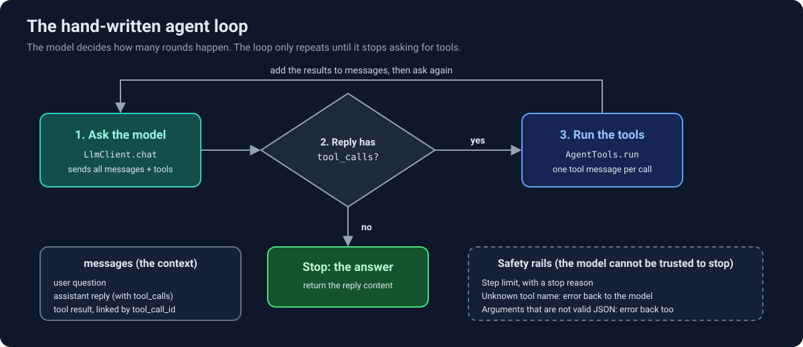

# Lesson 4: the agent loop, written by hand

A framework hides the loop that makes an agent an agent. This lesson writes it in about 25 lines of plain
Ruby: ask the model, run the tools it requests, give it the results, repeat until it answers. Then it checks
that the hand-written loop makes the same tool calls as `SupportAgent` (RubyLLM).

Last updated: 2026-10-12

## Status

- [x] Groq's tool-calling format read in its docs, then one raw request sent from the console
- [x] `LlmClient`: one request to Groq, returns the assistant message
- [x] `AgentTools`: tool definitions for the request, and a run-by-name allowlist over the four tool classes
- [x] `AgentLoop`: keeps the messages, repeats until the model answers
- [x] Safety rails: step limit with a stop reason, unknown tool name, arguments that are not valid JSON
- [x] A trace of each run
- [x] Console proof: `AgentLoop` and `SupportAgent` make the same tool call for the same question
- [x] Specs: six with a fake client, one recorded run
- [ ] Pull request merged and tag `lesson-04`

## How the loop works

<p align="center">
  
</p>

<details>
<summary>Text version</summary>

`AgentLoop` keeps one list, `messages`, and repeats three steps:

1. **Ask the model.** `LlmClient.chat` sends all the messages and the tool definitions to Groq. The model
   has no memory between calls, so the whole list goes every time.
2. **Check the reply.** If it has `tool_calls`, the model is asking for help. If it does not, its `content`
   is the final answer and the loop stops.
3. **Run the tools.** `AgentTools.run` finds each requested tool by name and runs it. The model's reply and
   one `tool` message per call (linked by `tool_call_id`) are added to `messages`, and the loop goes back to
   step 1.

Safety rails around the loop: a step limit (`max_steps`, default 5) ends a run that never answers, an
unknown tool name returns an error to the model instead of running anything, and arguments that are not
valid JSON also return an error to the model instead of crashing.

</details>

## What was built

```
app/agents/llm_client.rb      one request to Groq (Faraday), returns the assistant message
app/agents/agent_tools.rb     tool definitions for the request, and run(name, arguments) by name
app/agents/agent_loop.rb      the loop, the step limit, the error handling and the trace
app/agents/README.md          which agent the app uses and which one is the lesson
spec/agents/agent_loop_spec.rb  six specs with a fake client, one recorded run
```

`AgentLoop.new(client:, tools:, max_steps: 5).run(question)` returns a `Result` with the `answer`, a
`stop_reason` (`:answered` or `:step_limit`) and the `trace`.

## Hand-written versus RubyLLM

Both versions run the same four tool classes with the same Groq model. In the console, "Where is my order
4242?" gave the same tool call on both sides:

```
SupportAgent   get_shipment {"order_id" => 4242}
AgentLoop      get_shipment {"order_id":4242}
```

The only visible difference is that RubyLLM hands the arguments over already parsed, and the hand-written
loop parses the JSON string itself. With only `GetOrderTool` attached, the model chose `get_order` instead.
The tool descriptions are what it reads, so the choice depends on which tools it is offered.

| | `SupportAgent` (RubyLLM) | `AgentLoop` (by hand) |
| --- | --- | --- |
| Role | the agent the app uses | the lesson, nothing depends on it |
| Who repeats the loop | `chat.ask` | our `@max_steps.times` |
| Provider and HTTP | RubyLLM, configured in an initializer | one hard-coded Groq client |
| System prompt | `app/prompts/support_agent` | none yet |
| Streaming, retries, other providers | yes | no |

## Design decisions

| Decision | Choice | Why |
| --- | --- | --- |
| Who owns the messages | `AgentLoop` (a local array in `run`) | `LlmClient` and `AgentTools` stay stateless, so each is easy to test and replace. |
| Client passed in | `AgentLoop.new(client:, tools:)` | Specs hand it a fake client, so no spec needs Groq except the recorded one. |
| Tool descriptions | built from the existing `RubyLLM::Tool` wrappers | One place describes a tool, so both versions send the model the same words. |
| Errors in tools | a Hash the model can read, never a raise | The model can see its mistake and retry, the same rule the tools already follow. |
| Return value | `Result` struct with `answer`, `stop_reason`, `trace` | A cut-off run must not look like an answer. |
| Trace | one entry per model request and per tool call, raw arguments kept | Bad arguments show up exactly as the model sent them. |

## What broke

- **Reasoning text sent back.** Groq rejects the `reasoning` field of a message when it is sent back in
  the next request, so `LlmClient` sends `include_reasoning: false`. `SupportAgent` needs the same option
  for the same reason.
- **A reply with no `content`.** When the model asks for a tool, Groq's message has `tool_calls` and no
  `content` key at all, so the loop decides on `tool_calls`, not on `content`.
- **The raw arguments are a string.** Groq sends `"arguments":"{\"order_id\":4242}"` as a JSON string, so
  the loop must parse it, and the parse can fail.

## Proof

Six specs use a fake client that plays back canned replies, so they run without Groq: a plain answer, a
tool call whose result reaches the model, the step limit, an unknown tool, invalid JSON arguments (the tool
does not run), and the trace.

One recorded run (`spec/cassettes/agent_loop/looks_up_an_order.yml`) uses the real model with all four
tools, order 4242 and fixed dates. It holds three requests:

```
request 1: question                       -> model: get_shipment(order_id: 4242)
request 2: ... + get_shipment result      -> model: get_order(order_id: 4242)
request 3: ... + get_order result         -> final answer
```

The order had no shipment, so the first tool returned `{"error":"Order 4242 has no shipment"}`. The model
read that, asked for `get_order` on its own, and then answered. Nobody wrote that second round into the
code; the loop only repeated until the model stopped asking. The spec checks the first tool call's
arguments and the `:answered` stop reason, not the number of calls, because that can change between
recordings.

## Known gaps

- `AgentLoop` sends no system prompt, so it does not follow `SupportAgent`'s instructions.
- Arguments that are valid JSON but have the wrong keys raise an `ArgumentError` inside the tool call and
  stop the run. Only invalid JSON and unknown tool names are handled.
- The loop is tied to Groq's Chat Completions format through `LlmClient`.

## Scope

This shows that the loop works and matches the framework on one question. It does not measure how often the
model picks the right tool or whether its answers stay grounded. That is the job of the evals in Lesson 10.

## Learn more

- [FAQ](../FAQ.md): what an agent loop is, what `AgentTools` is for, safety rails versus guardrails, and
  why the loop is hand-written
- [Lesson 3](03-read-tools.md): the four tools the loop runs
- [app/agents/README.md](../../app/agents/README.md): which agent the app uses
